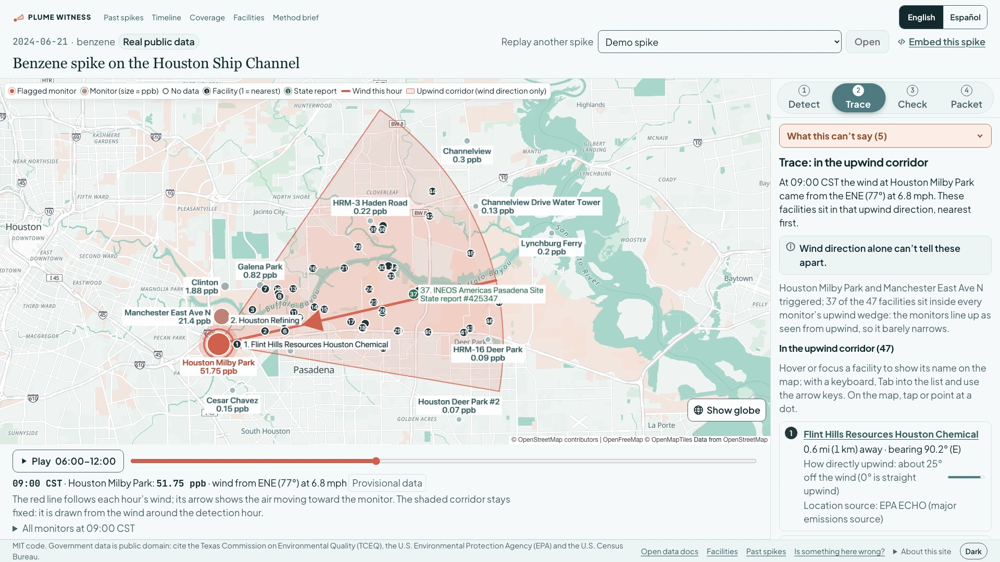
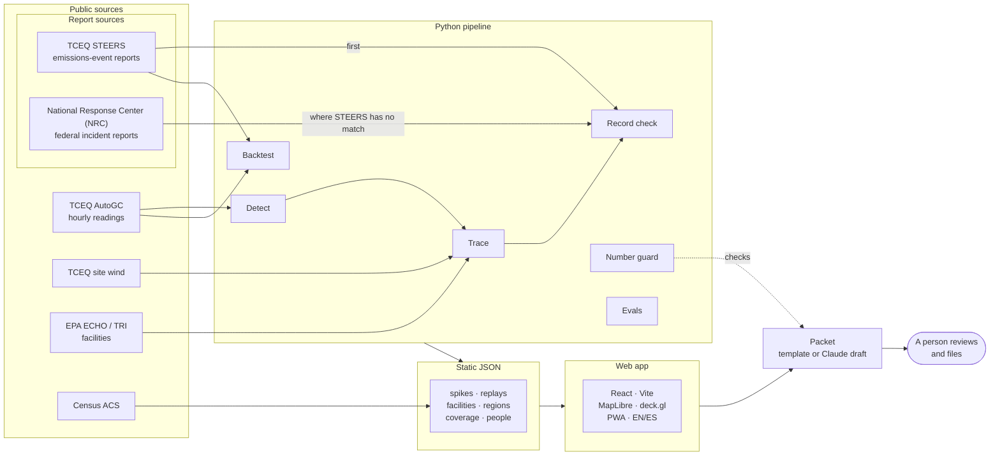

# Plume Witness



**A fact-checker for the pollution reports Texas companies file about themselves.** When a state air monitor spikes, Plume Witness traces the air upwind, lists the facilities in its path, and checks whether any of them filed the emissions-event report Texas requires.

[](https://kgorle1111.github.io/plume-witness/)
[](LICENSE)

**Live site:** [kgorle1111.github.io/plume-witness](https://kgorle1111.github.io/plume-witness/), static, no login, English and Spanish.

Built at GDG on Campus UCSC DevFest for the Best Social Impact track.

## What it does

Industrial facilities in Texas report their own unplanned releases ("emissions events") to the state. The Environmental Integrity Project counted 21,769 such events from FY2017 to FY2022, and the state designated 119 events (0.55%) excessive. <!-- CL-014 --> Advocates and reporters check these self-reports against what the air showed, by hand. Plume Witness does that check from public data, in four steps, on a real spike you can replay:

1. **Detect.** A spike on a state (TCEQ) regulator-grade monitor. On 2024-06-21 the Houston Milby Park monitor read 51.75 ppb of benzene in the 9:00 a.m. CST hour, against a 7-day median of 0.21 ppb, below the Texas 1-hour benzene health value. <!-- CL-001 --> Low-cost sensors are never the trigger. <!-- CL-010 -->
2. **Trace.** The wind came from 77 degrees <!-- CL-003 -->, and 47 major facilities sit in the upwind corridor, within 9.3 mi (15 km) and 22.5° of the wind direction. <!-- CL-004 --> This is wind direction at one monitor, not a dispersion model: it cannot tell facilities on the same bearing apart, so it lists them nearest first and never names a source.
3. **Check.** It pulls every emissions-event report filed that day in the county (2 reports, search complete) <!-- CL-007 --> and finds INEOS Americas Pasadena Site inside the corridor; the company's own report lists 7,634 lb of benzene. <!-- CL-005 --> The initial notice came 5 hours after discovery and the final report 12 days after the event ended, inside the 24 hours and 14 days Texas allows. For this spike the company reported, so the replay shows the check passing, not a missing report. <!-- CL-006 -->
4. **Packet.** A hedged evidence summary in English and Spanish, written by a fixed template from the event's own fields, with read-aloud and a number check that rejects any number or ID not in the input. <!-- CL-009 --> A person reads, edits, approves and files it; the app sends nothing. <!-- CL-008 -->

**Who it's for:** reporters, watchdog analysts and environmental volunteers who check these reports by hand today. TEJAS volunteers in Houston verify, document, share and translate each incident themselves <!-- CL-028 -->, and around the Galena Park monitor 77.1% of residents age 5 and over speak Spanish at home. <!-- CL-035 -->

Beyond the demo spike, the site has a Past spikes log of 468 Houston spikes at 12 monitors with a CSV download and a calendar, replays 466 of those spikes, and has a place search with neighborhood shortcuts. <!-- CL-031 --> It covers all 45 Texas AutoGC monitors in 10 regions on a Coverage page, runs the same check on every one with 2024-2025 data, and checks spikes against a second public report system, the federal National Response Center. It also has a two-year spike timeline, a history page for each of 194 facilities near the Houston monitors, RSS feeds per monitor, an embeddable replay for newsrooms, a printable 2-page method brief in English and Spanish, link previews, documented open data files ([docs/api.md](docs/api.md)), and install-as-app with offline replay. <!-- CL-033 -->

Every record check ends in one status label, the same on every page: **Reported**, **Filed after the window**, **Not yet reported**, **Reported, but doesn't match**, **Reported to NRC**, **No matching report** (a question, not a finding), or **Can't say**, followed by the cause, when something stopped the check short: for example "Can't say: wind too light".

## Results

**What the tool is for.** Hourly state monitors are a coarse instrument, so we don't claim to detect releases (the backtest below shows why). We turn 468 spikes into 167 specific questions for the state that no public report answers. <!-- source: web/src/landingMetrics.ts, recomputed from web/public/spikes.json by web/test/landingMetrics.test.ts -->

Measured on public data, for the Houston Ship Channel unless the row says otherwise.

| What we measured | Result | What it means |
|---|---|---|
| Spikes checked against the record, 12 monitors | Across all 468 spikes in the Past spikes log, 167 ended as No matching report after a complete search, and 284 ended with the search incomplete, labeled Can't say with the cause named <!-- CL-011 --> | Each No matching report is a question for the state, never a finding; the site counts these spikes and names no facility. |
| Second report source | Every spike is checked against the state's STEERS reports and, where STEERS has no match, the federal National Response Center's; the NRC's 1,508 reports for Harris and Jefferson counties added 0 matches <!-- CL-036 --> | The second source is checked only where STEERS has no corridor match. |
| Work a hand check takes | For each of the 167 No matching report spikes, checking by hand means searching the state's reports from the spike day and the 30 days before, reading a median of 1 report (up to 4), placing a median of 9 corridor facilities (up to 51) against the wind, and repeating at 14 days: 2,519 facility checks and 136 report reads in all <!-- source: HAND_CHECK in web/src/landingMetrics.ts, recomputed from web/public/nights/ by web/test/landingMetrics.test.ts --> | A count of the work, not a timing. The app has done it for all 468 spikes, and each answer is one click away in the Past spikes log. |
| Hand check of No matching report spikes | Of 10 picked at random, the gap held in 8 of 10, 2 of 10 could not be settled from public data, and 0 of 10 was a report the pipeline missed <!-- CL-032 --> | With 10 spikes the true miss rate could be as high as 28% (Wilson 95%). [docs/audit-no-report.md](docs/audit-no-report.md) |
| Backtest on releases companies reported | Of 82 reported releases, only 5 of 82 showed a spike at a state monitor from 1 hour before to 6 hours after the reported start, and the pipeline matched 1 of 82 end to end <!-- CL-023 --> | A spike near the start is consistent with the release, not proof it caused the reading. [docs/backtest.md](docs/backtest.md) |
| What hourly monitors can see | In 64 of 82 a state monitor within 9.3 mi (15 km) was downwind near the start, yet ordinary days at the same monitors and hours spiked in 27 of 429 windows <!-- CL-029 --> | The 95% intervals overlap at every setting tested, so these monitors cannot tell these releases apart from ordinary days at the same hours. [docs/detector.md](docs/detector.md) |
| Beaumont-Port Arthur, same backtest | Of 81 releases companies reported in Jefferson County, a monitor with data was downwind of 37 of 81 near the reported start, yet 0 of 81 had a trigger hit then and 0 of 81 matched end to end; ordinary-day control windows hit 0 of 413 <!-- CL-037 --> | Readings above 10 ppb are rare at these 2 monitors, so this mostly shows the trigger does not fire there. [docs/backtest-beaumont.md](docs/backtest-beaumont.md), [docs/detector-beaumont.md](docs/detector-beaumont.md) |
| A spike with no answer | On March 29, 2024 at 23:00 CST Galena Park read 15.84 ppb of benzene against a usual 0.27 ppb; 12 facilities sit upwind, and a hand check found no report of any type running within 12 hours <!-- CL-034 --> | The gap is a question for the state, not a finding that a release went unreported. |

## Architecture



The pipeline is deterministic and runs from cached public files: every value comes from public data, and each raw file is stored under `data/raw/` with its source URL, fetch time and SHA-256 hash. <!-- CL-018 --> The record check reads two report systems: the state's STEERS emissions-event reports first, then the federal National Response Center's incident reports for any spike STEERS has no corridor match for. The site is static: no server, no account, no API key in the browser. It runs in a phone or laptop browser, and the Trace step lists every corridor facility as text, so the map is never the only way to read it. <!-- CL-021 -->

## Tech stack

| Layer | What we use |
|---|---|
| Pipeline | Python 3.12, [uv](https://docs.astral.sh/uv/), pytest, Ruff, tzdata (`pipeline/`, `tests/`, `evals/`) |
| Data sources | TCEQ AutoGC hourly VOCs and site meteorology, TCEQ STEERS emissions-event reports, US Coast Guard National Response Center (NRC) incident reports, EPA ECHO facility locations and TRI totals, U.S. Census Bureau ACS (tract level) |
| Web | Vite, React 19, TypeScript, MapLibre GL, deck.gl, Motion, OpenFreeMap tiles, service worker and web manifest (installable PWA, offline replay), English and Spanish UI (`web/src/i18n.ts`), oxlint, `node --test` |
| AI | Anthropic Python SDK: Claude Opus 5.5 (`claude-opus-5-5`) writes the optional packet draft (`pipeline/claude_draft.py`); Claude Sonnet 5.5 (`claude-sonnet-5-5`) reads companies' report revisions (`pipeline/walkback.py`). Google Gen AI SDK for an alternate Gemini drafter behind the same guard, not used by the live site ([docs/gemini.md](docs/gemini.md)). Model output passes a deterministic number guard, which has its own guard-escape eval ([evals/guard_escape](evals/guard_escape/RESULTS.md)). |
| Voice | Kokoro text-to-speech, voices `af_heart` (English) and `ef_dora` (Spanish), pre-generated for read-aloud (`pipeline/voice.py`) |
| Design | Plus Jakarta Sans and JetBrains Mono (Fontsource), light and dark themes |
| CI/CD | GitHub Actions (Ruff, pytest, web build, oxlint and web tests on every pull request); GitHub Pages deploy gated on the web tests |

Exact versions are pinned in [pyproject.toml](pyproject.toml), [uv.lock](uv.lock) and [web/package-lock.json](web/package-lock.json).

## How we built it

- **Deterministic first.** Detection, the upwind corridor and the record check are plain, tested Python on public data. No model decides a result a reader sees.
- **Every number traces to a source.** A claims file names the evidence file and hash behind each number in our public copy, and a linter (truthlint) checks the copy against it before it ships.
- **The model sits behind a guard.** Claude drafts only behind a number guard that rejects any number, ID or time not in the input, and the guard is scored by its own eval. The Claude draft on the site was published because it passed that check. <!-- CL-022 -->
- **One fix per pull request.** Every change lands as its own PR with CI; the Pages deploy runs the web tests before it publishes.
- **Independent review.** Hand audits, a backtest against companies' own reports, and separate review passes checked the method, the numbers and the copy.
- **AI-assisted, human-decided.** Claude Code (Claude Opus 5.5) wrote much of the pipeline and web code with the builder; every commit it helped with carries a Co-Authored-By trailer, and the team made each decision. <!-- CL-020 -->

## Roadmap

- Place every report on the map with a reviewed lookup table of TCEQ regulated-entity numbers.
- A labeled eval for the report-revision ("walk-back") reader, then ship it.
- One statewide list of open questions across all 10 regions.
- AI drafts for every replayable spike, behind the same guard.

## Method and limits

Plume Witness checks records; it does not assign blame. The limits that change what a reader should conclude:

- **The corridor is geometry, not a plume model.** Wind at one monitor cannot tell facilities on the same bearing apart, so the app lists them and checks the record instead of naming a source. When the wind is under 3 mph there is no corridor to draw, and the check says Can't say: wind too light.
- **A missing report is a question, not a finding.** Texas requires an initial notice within 24 hours and a final record within 14 days only for an emissions event at or above a reportable quantity (30 TAC 101.201 in the Texas Administrative Code) <!-- CL-013 -->, air readings cannot measure how much was released, and other sources raise readings too. A matching report is not proof the facility caused every reading either.
- **How often No matching report is wrong is estimated only from the hand check.** That check covered 10 spikes and had one reviewer.
- **Hourly state monitors are a coarse instrument.** For the releases we backtested, they cannot confirm or contradict a company's report (see Results). The backtests compare each release with its start day only, and cover the 12 Houston Ship Channel monitors and the 2 Beaumont-Port Arthur monitors.
- **The NRC is a weaker second source.** Its reports are initial phone reports, not validated, with a start time and no end, and their company names often differ from EPA's, so few can be placed on the map.
- **Only regulator-grade monitors.** It sees what TCEQ's AutoGC monitors see, and many neighborhoods have none. TCEQ labels AutoGC data provisional.
- **A person files.** Every packet is reviewed, edited and filed by a person.

The app keeps these limits on every step in a "What this can't say" panel. <!-- CL-017 --> The full method is in the [method brief](docs/brief.md) (also on the site at `?view=brief`, and in Spanish in [docs/brief.es.md](docs/brief.es.md)) and the [backtest report](docs/backtest.md).

## Run it locally

Requires Python 3.12 with [uv](https://docs.astral.sh/uv/), and Node 24 (the web tests use Node's built-in TypeScript support).

```bash
git clone https://github.com/kgorle1111/plume-witness.git
cd plume-witness

# Pipeline and tests
uv sync
uv run pytest -q

# Web app
cd web
npm ci
npm run dev        # open the printed local URL, then "Enter the replay"

# Web tests (the offline-cache test reads the build output)
npm run build
npm test
```

Use `?intro=0#detect` to open the demo spike directly, or a step hash such as `#packet` to deep-link to a step. The pipeline regenerates the site's data from the cached raw files, for example `uv run python -m pipeline.nights` and `uv run python -m pipeline.backtest`; [docs/api.md](docs/api.md) documents every JSON file the site serves.

## Data sources and licenses

| Source | Used for | License / terms |
|---|---|---|
| [TCEQ](https://www.tceq.texas.gov/) AutoGC hourly readings and site meteorology | Detect, Trace | Public government data; cite TCEQ |
| TCEQ STEERS Air Emission Event Report Database | Check (first report source) | Public government records; cite TCEQ |
| [US Coast Guard National Response Center](https://nrc.uscg.mil/) incident reports | Check (second report source) | U.S. federal data, public domain; NRC marks them initial and not validated |
| [EPA ECHO](https://echo.epa.gov/) and [TRI](https://www.epa.gov/toxics-release-inventory-tri-program) | Facility locations and yearly totals | U.S. federal data, public domain |
| [U.S. Census Bureau ACS](https://www.census.gov/programs-surveys/acs) | Who lives near each monitor ([docs/people.md](docs/people.md)) | U.S. federal data, public domain |
| [OpenStreetMap](https://www.openstreetmap.org/copyright) via [OpenFreeMap](https://openfreemap.org/) | Base map | Map data © OpenStreetMap contributors (ODbL) |

Every raw file is kept under `data/raw/` with its URL, fetch time and SHA-256 in the neighboring `provenance.json`.

## Credits

- **Kannishk Naidu**: pipeline, AI drafting and data; submits the project.
- **Chanchal**: landing page design and build; final check.
- **Nagatanmayee** ([@NagaGun](https://github.com/NagaGun)): replay redesign, ported into the app in PR #117.

## License

Code is MIT. See [LICENSE](LICENSE).
